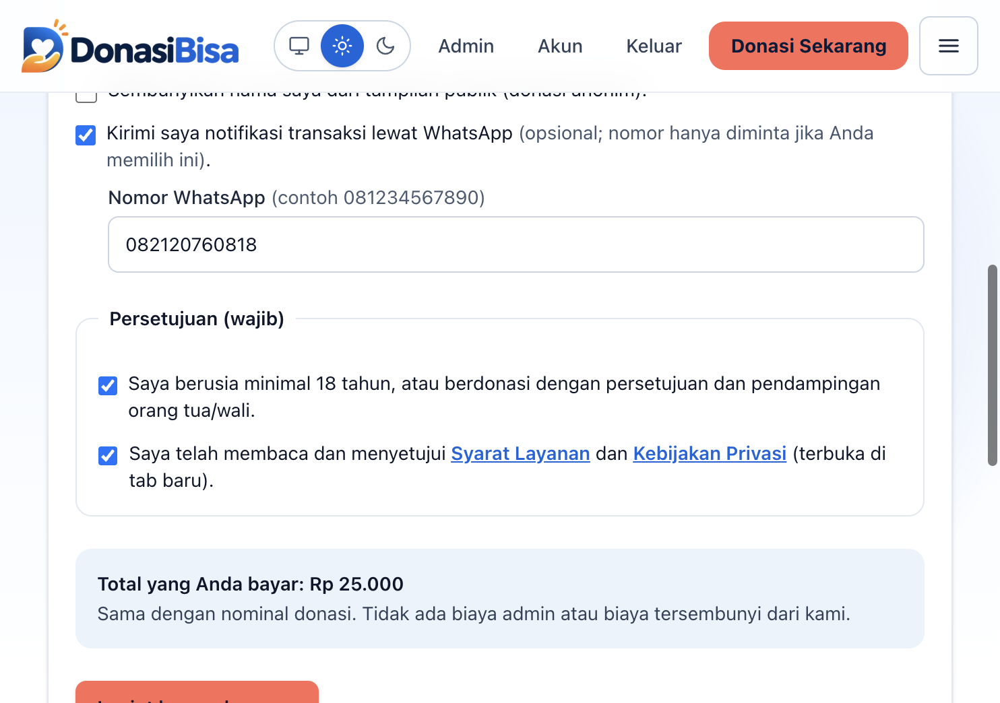
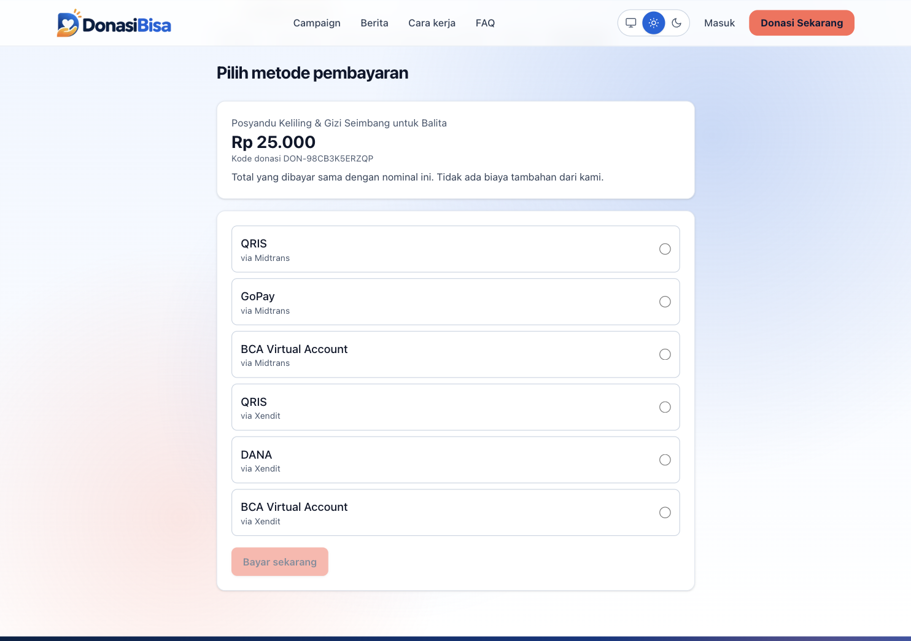
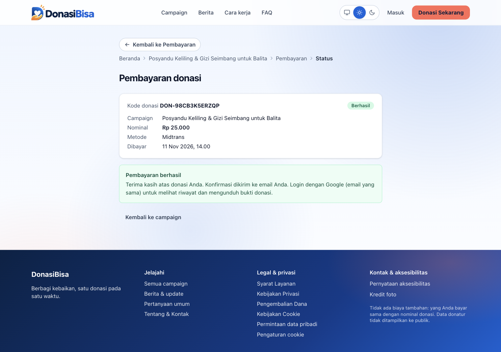
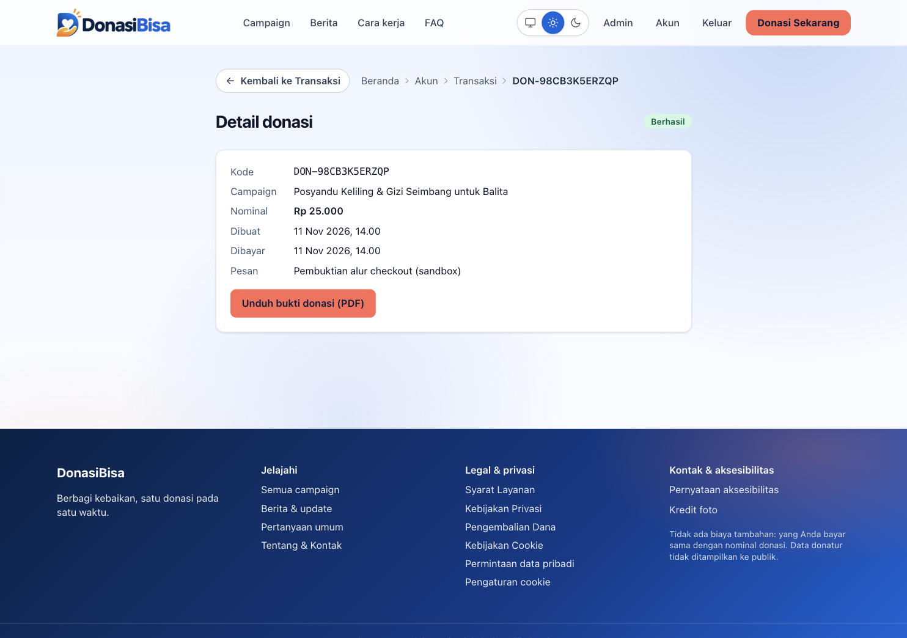
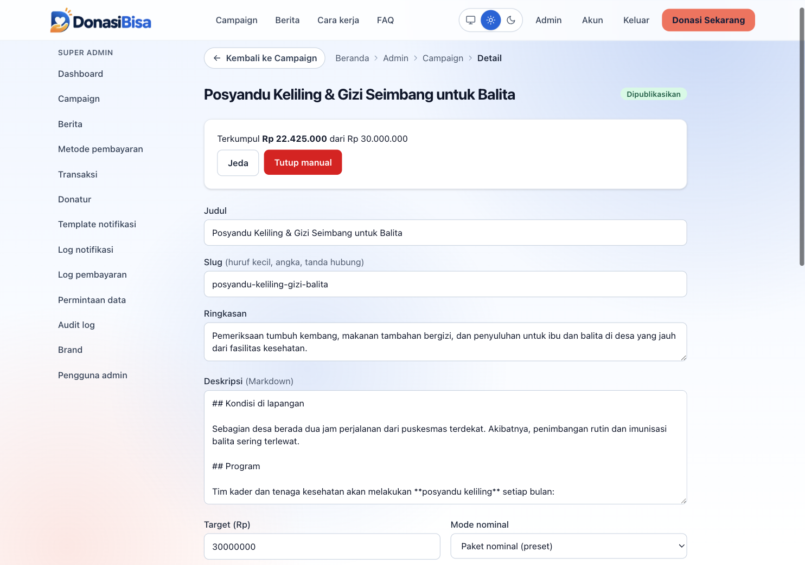
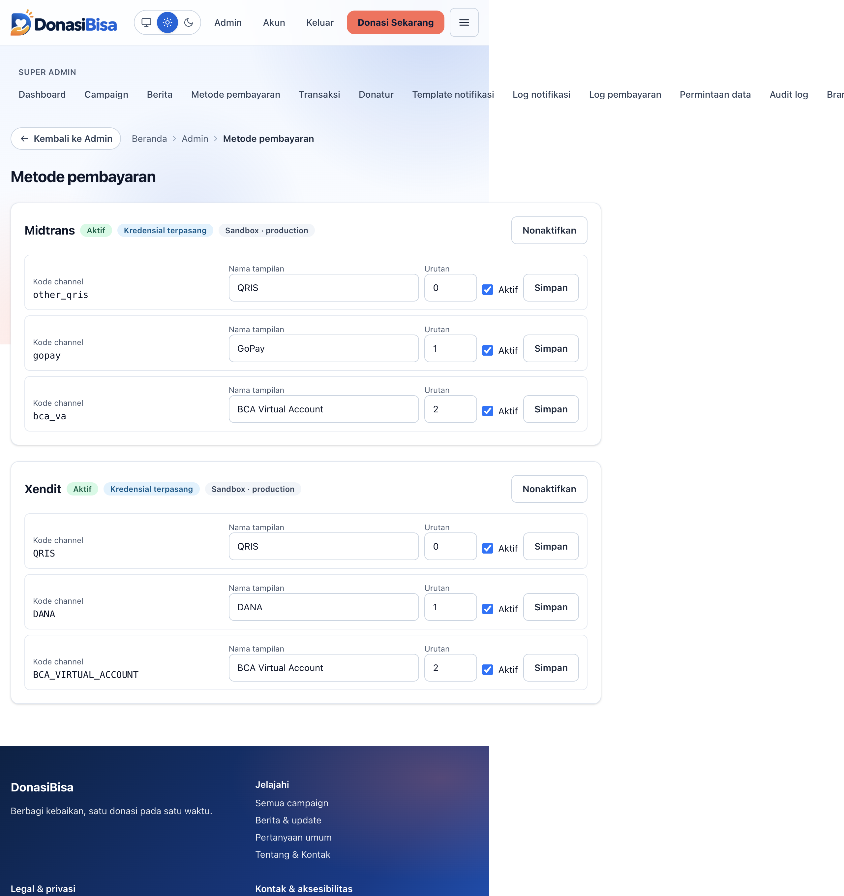

# Panduan Penggunaan DonasiBisa

Panduan dari awal sampai akhir untuk tiga peran:

- **[A. Donatur](#a-donatur)**: berdonasi, membayar, mengunduh bukti, mengatur data pribadi.
- **[B. Admin](#b-admin)**: mengelola campaign, berita, metode pembayaran, notifikasi, brand, pengguna, dan permintaan data.
- **[C. Operator / developer](#c-operator--developer)**: menjalankan, mengonfigurasi, dan men-deploy aplikasi, termasuk pindah dari sandbox ke live.

Alamat produksi: `https://donasibisa.vercel.app`. Isi screenshot di panduan ini diambil dari mode sandbox.

---

## A. Donatur

### A.1 Berdonasi (tanpa login)

1. Buka beranda atau `/campaigns`. Campaign bisa disaring per kategori (Pendidikan, Kesehatan, Bencana, Sosial, Lainnya).
2. Buka satu campaign. Halaman menampilkan jumlah terkumpul, target, jumlah donatur, sisa waktu, dan update dari campaign.
3. Klik **Donasi Sekarang**. Anda tidak perlu login.
4. Isi formulir:
   - Pilih **paket nominal** atau isi **nominal bebas**, tergantung mode campaign. Batas bawah dan atas diatur server (bawaan Rp 10.000 sampai Rp 100.000.000).
   - Isi nama, email, dan pesan atau doa (opsional). Pilihan "Sembunyikan nama saya dari tampilan publik" membuat donasi anonim.
   - Isi nomor WhatsApp **hanya** jika Anda ingin notifikasi lewat WhatsApp.
   - Centang persetujuan Syarat Layanan dan Kebijakan Privasi, dan konfirmasi usia. Keduanya wajib dan dicatat per donasi.
5. Klik tombol kirim. Tombol dikunci setelah diklik pertama supaya tidak terkirim dua kali.



Total yang dibayar sama dengan nominal donasi. Tidak ada biaya tambahan dari DonasiBisa.

### A.2 Memilih metode dan membayar

1. Halaman **Pilih metode pembayaran** menampilkan metode yang sedang aktif (misalnya QRIS, GoPay, DANA, BCA Virtual Account, lewat Midtrans atau Xendit). Admin dapat mengubah daftarnya kapan saja.
2. Pilih satu metode, lalu klik **Bayar sekarang**. Anda diarahkan ke halaman pembayaran gateway.
3. Selesaikan pembayaran sesuai metode:
   - **Virtual Account:** transfer ke nomor VA yang ditampilkan.
   - **QRIS:** pindai QR dengan aplikasi e-wallet atau m-banking.
   - **GoPay / DANA:** ikuti pengalihan ke aplikasinya.
4. Selesaikan sebelum batas waktu yang tertera (hitung mundur di halaman gateway). Lewat batas, pembayaran kedaluwarsa dan Anda bisa membuat donasi baru.



### A.3 Status donasi

- Halaman `/payment/<kode-donasi>` menampilkan status: **Menunggu**, **Berhasil**, atau **Gagal/Kedaluwarsa**.
- Status "Berhasil" hanya muncul setelah gateway mengonfirmasi lewat webhook. Pengalihan balik dari gateway saja tidak mengubah status.
- Setelah berhasil, jumlah terkumpul dan jumlah donatur di campaign bertambah.



### A.4 Notifikasi

Anda menerima email (dan WhatsApp bila diisi) saat donasi dibuat, berhasil, dan gagal atau kedaluwarsa. Setiap pesan memuat tautan **berhenti berlangganan**. Jika Anda berhenti berlangganan, Anda tetap menerima konfirmasi pembayaran berhasil, karena itu bukti transaksi.

### A.5 Login dan mengunduh bukti donasi

1. Buka `/login` dan klik **Masuk dengan Google**. Gunakan email yang sama dengan yang dipakai saat donasi.
2. Buka **Akun → Transaksi** (`/account/transactions`). Donasi dengan email Anda otomatis tertaut.
3. Buka salah satu donasi, lalu klik **Unduh bukti donasi (PDF)**.



Anda hanya bisa membuka donasi milik sendiri. Donasi orang lain mengembalikan halaman tidak ditemukan.

### A.6 Privasi dan data pribadi

Di **Akun → Privasi** (`/account/privacy`) Anda bisa:
- **Mengunduh** data pribadi Anda (format JSON).
- **Menghapus akun**. Data donasi dianonimkan; catatan keuangan tetap disimpan tanpa identitas.

Tanpa login, ajukan permintaan lewat `/permintaan-data`. Halaman lain: `/privacy`, `/terms`, `/refund`, `/cookies`, `/aksesibilitas`, `/tentang`, dan **Pengaturan cookie** di footer. Tema terang/gelap/perangkat diatur dari tombol di header.

> Campaign berlabel **DEMO** adalah data contoh, bukan penggalangan dana nyata.

---

## B. Admin

### B.1 Masuk dan peran

Login Google di `/login`, lalu buka `/admin`. Email yang tercantum di `ADMIN_EMAIL_ALLOWLIST` otomatis menjadi **Super Admin** pada login pertama. Pengguna tanpa peran admin mendapat halaman tidak ditemukan.

| Peran | Bisa |
|---|---|
| **Super Admin** | Semua fitur |
| **Campaign Admin** | Kelola dan publikasikan campaign, baca berita dan transaksi |
| **Finance Admin** | Lihat pembayaran, transaksi, donatur, notifikasi, campaign (baca) |
| **Content Admin** | Kelola dan publikasikan berita, baca campaign |

Menu admin: Dashboard, Campaign, Berita, Metode pembayaran, Transaksi, Donatur, Template notifikasi, Log notifikasi, Log pembayaran, Permintaan data, Audit log, Brand, Pengguna admin. Menu yang tidak diizinkan untuk peran Anda ditolak di server.

### B.2 Mengelola pengguna admin (Super Admin)

`/admin/users`: berikan atau cabut peran untuk pengguna yang sudah pernah login. Setiap perubahan tercatat di Audit log.

### B.3 Membuat dan mengubah campaign

1. **Admin → Campaign → Baru**.
2. Isi judul, slug (huruf kecil, angka, tanda hubung), ringkasan, deskripsi (Markdown), kategori, gambar sampul (URL HTTPS) dan **teks alt** gambar, target, tanggal berakhir, serta mode nominal (paket preset atau nominal bebas).
3. Simpan. Campaign baru berstatus **Draft** dan belum tampil publik.
4. Untuk mengubah isi, buka campaign dari daftar, ubah, lalu simpan. Halaman publik diperbarui langsung.



**Status campaign:**

| Status sekarang | Tombol yang tersedia |
|---|---|
| Draft | Publikasikan |
| Dipublikasikan | Jeda, Tutup manual |
| Dijeda | Lanjutkan, Tutup manual |
| Selesai (target tercapai) / Ditutup | Arsipkan |

Campaign otomatis ditutup atau selesai oleh job terjadwal saat tanggal berakhir lewat atau target tercapai. Campaign yang dijeda, ditutup, atau diarsipkan tidak menerima donasi baru.

### B.4 Berita

`/admin/news`: buat, ubah, publikasikan, atau hapus berita dan update campaign. Isi memakai Markdown (disanitasi). Berita bisa dikaitkan ke satu campaign sehingga muncul di bagian "Update campaign".

### B.5 Metode pembayaran (tampilkan / sembunyikan)

`/admin/payment-methods`:
- **Nonaktifkan / Aktifkan** satu provider (Midtrans atau Xendit) dengan tombol di kanan judul. Provider hanya bisa diaktifkan jika kredensialnya terpasang.
- Per channel: ubah **nama tampilan**, **urutan**, dan centang **Aktif**, lalu klik **Simpan**. Channel yang dinonaktifkan langsung hilang dari halaman pilih metode donatur.
- **Kode channel** harus sama dengan kode yang aktif di akun gateway (Midtrans: `other_qris`, `gopay`, `bca_va`; Xendit: `QRIS`, `DANA`, `BCA_VIRTUAL_ACCOUNT`). Jangan diubah kecuali Anda tahu kodenya.



### B.6 Transaksi, donatur, dan log

- **Transaksi:** daftar semua donasi dengan status, nominal, campaign, dan metode. 
- **Donatur:** daftar dan detail donatur beserta riwayat donasinya.
- **Log pembayaran:** event webhook dari gateway (diterima, diproses, ditolak). Berguna untuk menelusuri donasi yang tidak berubah menjadi berhasil.
- **Log notifikasi:** status tiap pesan (terkirim, gagal, dilewati) per donasi, kanal, dan jenis.
- **Audit log:** siapa mengubah apa dan kapan.

> Refund yang dikonfirmasi gateway hanya mengubah status donasi. Jumlah terkumpul campaign tidak dikurangi secara otomatis. Itu keputusan desain, bukan bug.

### B.7 Template notifikasi

`/admin/notification-templates`: ubah subjek dan isi email serta WhatsApp untuk tiga kejadian: donasi dibuat (menunggu pembayaran), pembayaran berhasil, pembayaran gagal/kedaluwarsa. Variabel yang boleh dipakai:

`{{donor_name}}`, `{{donation_code}}`, `{{campaign_title}}`, `{{amount}}`, `{{payment_url}}`, `{{receipt_url}}`, `{{brand_name}}`

Variabel di luar daftar ditolak saat disimpan.

### B.8 Brand dan data bisnis

`/admin/brand`: nama brand, warna, logo (URL HTTPS), kontak, dan **detail bisnis/legal** (nama badan, alamat, dan sejenisnya) yang tampil di footer dan halaman legal. Isi lengkap sebelum go-live.

### B.9 Permintaan data pribadi

`/admin/data-requests`: permintaan akses/penghapusan dari donatur. Tandai **Selesai** atau **Tolak**; pada penghapusan Anda bisa memilih sekaligus menganonimkan data donatur.

### B.10 Membaca hasil uji

Bukti uji sandbox ada di [EVIDENCE.md](EVIDENCE.md): checkout sampai paid, tampil/sembunyi metode, edit campaign, dan unduh bukti donasi.

---

## C. Operator / developer

### C.1 Menjalankan lokal

Prasyarat: Node.js >= 20.19, Docker.

```bash
npm install
cp .env.example .env.local
docker compose up -d        # Postgres di localhost:5433
npm run db:migrate
npm run db:seed             # brand, provider, template, data DEMO
npm run dev                 # http://localhost:3000
```

Mode development memakai **simulator gateway lokal** bila kredensial gateway kosong (`APP_ENV=development` dan `PAYMENT_SIMULATOR=true`). Di halaman `/dev/pay/...` klik **Bayar berhasil** untuk mengirim webhook bertanda tangan. Simulator tidak aktif di produksi.

Perintah lain: `npm run lint`, `typecheck`, `test` (butuh Postgres lokal), `build`, `db:generate`, `db:studio`, `jobs:run`.

### C.2 Variabel lingkungan

Salin dari `.env.example`. Ringkasnya:

| Kelompok | Variabel |
|---|---|
| Aplikasi | `APP_ENV` (`development`/`preview`/`production`), `NEXT_PUBLIC_APP_URL`, `AUTH_SECRET`, `ADMIN_EMAIL_ALLOWLIST` |
| Database | `DATABASE_URL` (pooled), `DATABASE_URL_DIRECT` (untuk migrasi) |
| Google login | `AUTH_GOOGLE_ID`, `AUTH_GOOGLE_SECRET`, `AUTH_TRUST_HOST` |
| Midtrans | `MIDTRANS_SERVER_KEY`, `MIDTRANS_CLIENT_KEY`, `MIDTRANS_SIGNATURE_SECRET_KEY`, `MIDTRANS_IS_PRODUCTION`, `PAYMENTS_MIDTRANS_ENABLED` |
| Xendit | `XENDIT_SECRET_KEY`, `XENDIT_WEBHOOK_TOKEN`, `PAYMENTS_XENDIT_ENABLED` |
| Cache / job | `UPSTASH_REDIS_REST_URL/TOKEN`, `QSTASH_URL`, `QSTASH_TOKEN`, `QSTASH_CURRENT_SIGNING_KEY`, `QSTASH_NEXT_SIGNING_KEY` |
| Email | `SMTP_USER`, `SMTP_APP_PASSWORD`, `EMAIL_FROM_NAME`, `EMAIL_FROM_ADDRESS`, `NOTIFICATIONS_EMAIL_ENABLED` (atau `RESEND_API_KEY`) |
| WhatsApp | `FONNTE_TOKEN`, `NOTIFICATIONS_WHATSAPP_ENABLED` |
| Donasi | `MIN_DONATION_AMOUNT`, `MAX_DONATION_AMOUNT` |

Rahasia hanya disimpan di env, jangan di-commit.

### C.3 Setup layanan eksternal

**Google login.** Di Google Cloud Console buat OAuth client (Web application). Tambahkan redirect URI `https://DOMAIN/api/auth/callback/google` (dan `http://localhost:3000/api/auth/callback/google` untuk lokal). Isi `AUTH_GOOGLE_ID` dan `AUTH_GOOGLE_SECRET`.

**Neon Postgres.** Pakai connection string pooled untuk `DATABASE_URL` dan unpooled untuk `DATABASE_URL_DIRECT`. Terapkan skema dengan `npm run db:migrate`.

**Midtrans.** Di dashboard Midtrans (Settings → Access Keys) ambil Server Key, Client Key, dan Signature Secret Key. Daftarkan **Payment Notification URL** `https://DOMAIN/api/webhooks/midtrans`. Sandbox memakai kunci berawalan `SB-Mid-`.

**Xendit.** Buat API key (Secret) dan webhook verification token. Daftarkan callback `https://DOMAIN/api/webhooks/xendit` untuk event sukses, gagal, dan kedaluwarsa, dengan token yang sama dengan `XENDIT_WEBHOOK_TOKEN`.

**Email (Gmail SMTP).** Aktifkan verifikasi 2 langkah, buat App Password, isi `SMTP_USER` dan `SMTP_APP_PASSWORD`, set `NOTIFICATIONS_EMAIL_ENABLED=true`.

**WhatsApp (Fonnte).** Hubungkan perangkat di Fonnte, isi `FONNTE_TOKEN`, set `NOTIFICATIONS_WHATSAPP_ENABLED=true`.

**Upstash.** Redis untuk cache dan rate limit (opsional; kosong berarti in-memory). QStash untuk job terjadwal dan pengiriman notifikasi; jalankan `npm run qstash:schedules` untuk membuat jadwal:

| Endpoint | Cron (UTC) |
|---|---|
| `/api/internal/jobs/campaign-lifecycle` | `*/5 * * * *` |
| `/api/internal/jobs/expire-payments` | `*/10 * * * *` |
| `/api/internal/jobs/notifications` | `*/15 * * * *` |

### C.4 Deploy ke Vercel

Deploy berjalan lewat GitHub Actions (`.github/workflows/deploy.yml`): push ke `main` = produksi, pull request = preview. Secret yang dibutuhkan di GitHub: `VERCEL_TOKEN`, `VERCEL_ORG_ID`, `VERCEL_PROJECT_ID`. Isi seluruh variabel lingkungan di Vercel dan pastikan `APP_ENV=production`.

**Urutan aman setiap rilis:**
1. Jalankan `npm run lint`, `npm run typecheck`, `npm test`, `npm run build`.
2. Jalankan `npm run db:migrate` ke database produksi bila ada migrasi baru, **sebelum** merge.
3. Push ke `main`, tunggu deploy selesai, lalu cek `/`, `/campaigns`, `/login`.

### C.5 Pindah dari sandbox ke live

Lakukan hanya setelah semua poin ini selesai:

1. Akun merchant Midtrans dan/atau Xendit sudah lolos verifikasi bisnis.
2. Ganti kunci ke kunci **live** di Vercel (Midtrans: kunci tanpa `SB-`, `MIDTRANS_IS_PRODUCTION=true`). Daftarkan ulang URL webhook di dashboard live.
3. Pastikan kode channel di `/admin/payment-methods` sesuai metode yang aktif di akun live.
4. Isi data bisnis di **Admin → Brand** dan minta penasihat hukum meninjau halaman Syarat, Privasi, Refund, dan Cookie. Teksnya masih draf.
5. Hapus atau arsipkan campaign **DEMO**. Saat kunci live terpasang, campaign DEMO otomatis menolak donasi.
6. Lakukan satu donasi kecil sungguhan dan pastikan: status berhasil, notifikasi terkirim, angka campaign naik, dan bukti PDF bisa diunduh.

### C.6 Pemecahan masalah

| Gejala | Kemungkinan penyebab dan tindakan |
|---|---|
| Donasi tetap "Menunggu" setelah bayar | Webhook tidak sampai atau ditolak. Cek **Log pembayaran**; pastikan URL webhook benar dan signature/token sama dengan yang di env. |
| Webhook Midtrans ditolak `INVALID_SIGNATURE` | Isi `MIDTRANS_SIGNATURE_SECRET_KEY` dengan Signature Secret Key dari dashboard. |
| Metode pembayaran tidak muncul | Provider belum aktif, kredensial kosong, atau channel dinonaktifkan di `/admin/payment-methods`. |
| Notifikasi berstatus SKIPPED | Kanal belum diaktifkan atau kredensial kosong (`NOTIFICATIONS_*_ENABLED`, SMTP/Fonnte). |
| Email/WhatsApp tidak terkirim | Lihat **Log notifikasi** untuk pesan error; cek App Password Gmail atau status perangkat Fonnte. |
| Tidak bisa masuk `/admin` | Email Anda belum ada di `ADMIN_EMAIL_ALLOWLIST` atau belum diberi peran. Login dulu, lalu minta Super Admin memberi peran. |
| Job terjadwal tidak jalan | Jadwal QStash belum dibuat (`npm run qstash:schedules`) atau signing key salah. Endpoint job menolak request tanpa signature (401). |
| Simulator QRIS Midtrans sandbox menjawab "Transaction is unsuccessful" | Keterbatasan simulator sandbox untuk QRIS dari Snap. Uji dengan BCA VA (Midtrans) atau simulasi QRIS di dashboard Xendit mode Test. |

### C.7 Referensi

- [README.md](../README.md): ringkasan teknis dan keputusan terbuka.
- [CONTRACTS.md](CONTRACTS.md): kontrak antar modul.
- [COMPLIANCE.md](COMPLIANCE.md): audit privasi, SDK pihak ketiga, dan aksesibilitas.
- [EVIDENCE.md](EVIDENCE.md): bukti uji sandbox.
- [IMAGE-CREDITS.md](IMAGE-CREDITS.md): kredit foto.
