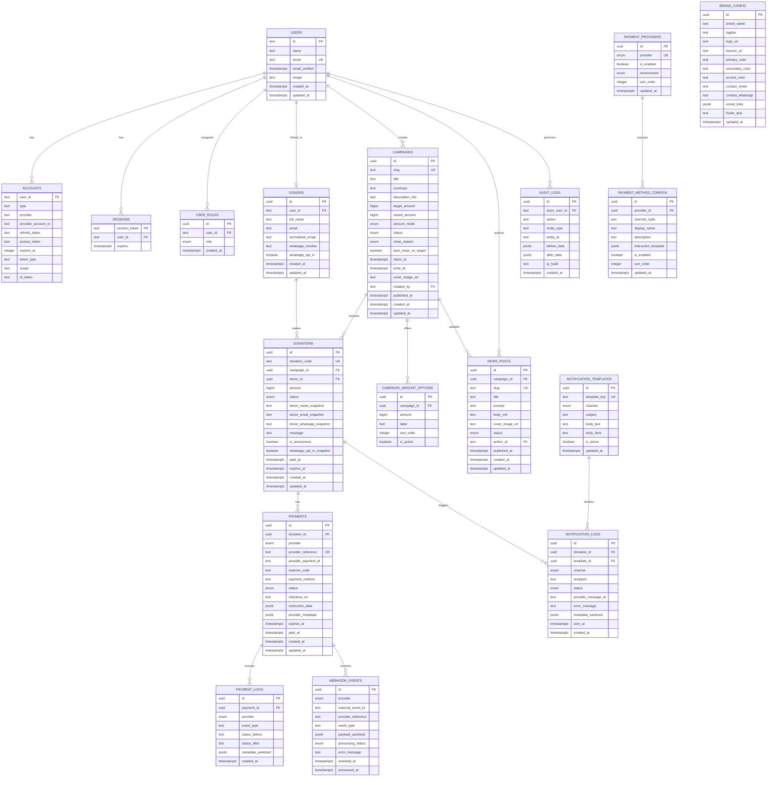

# Entity Relationship Diagram (ERD)

> Database: Neon PostgreSQL · ORM: Drizzle ORM · Model: single organization / single brand.
>
> ERD ini adalah rancangan implementasi. Nama kolom dapat disesuaikan saat membuat Drizzle schema, tetapi kontrak status dan relasi bisnis harus dipertahankan.

## 1. Prinsip Data

1. Semua nominal disimpan sebagai integer/bigint dalam IDR, bukan float/decimal floating point.
2. Database timestamp disimpan UTC (`timestamptz`); tampilan menggunakan `Asia/Jakarta`.
3. ID internal menggunakan UUID kecuali tabel Auth.js yang menggunakan text ID agar kompatibel dengan adapter.
4. Semua slug, donation code, provider reference, dan identitas external yang perlu unik diberi unique constraint.
5. Status transaksi adalah status internal yang dinormalisasi, bukan status mentah provider.
6. Event webhook dan log disimpan sebagai audit trail. Payload sensitif harus disensor/minimalkan.
7. Payment provider secrets tidak disimpan di database. Database hanya menyimpan konfigurasi publik metode pembayaran.
8. Data donor yang digunakan pada saat donasi disalin sebagai snapshot di donation agar bukti transaksi tetap konsisten meskipun profil donor berubah.

## 2. Mermaid ERD



## 3. Table Detail

### 3.1 `users`, `accounts`, `sessions`

Mengikuti model Auth.js Drizzle Adapter. Gunakan struktur yang sesuai dengan versi adapter saat implementasi.

**users**

| Kolom | Tipe | Constraint | Catatan |
|---|---|---|---|
| `id` | text | PK | Auth.js adapter identifier |
| `name` | text | nullable | Nama dari Google |
| `email` | text | unique, nullable sesuai adapter | Email Google |
| `email_verified` | timestamptz | nullable | Penting untuk donor linking |
| `image` | text | nullable | Avatar Google |
| `created_at`, `updated_at` | timestamptz | default now | Tambahan opsional |

`accounts` menyimpan provider account Google dan token OAuth sesuai kebutuhan Auth.js. Batasi akses tabel ini; jangan log token. `sessions` menyimpan session token bila strategi database session dipilih. `verification_tokens` dapat ditambahkan sesuai schema adapter yang dipakai.

### 3.2 `user_roles`

| Kolom | Tipe | Constraint | Catatan |
|---|---|---|---|
| `id` | uuid | PK | |
| `user_id` | text | FK users, cascade delete | |
| `role` | enum | not null | `SUPER_ADMIN`, `CAMPAIGN_ADMIN`, `FINANCE_ADMIN`, `CONTENT_ADMIN` |
| `created_at` | timestamptz | default now | |

Unique constraint: `(user_id, role)`. User dapat memiliki lebih dari satu role. Donor login tidak otomatis memperoleh role admin. Super Admin pertama di-bootstrap dari `ADMIN_EMAIL_ALLOWLIST` dan hanya setelah email Google tervalidasi.

### 3.3 `donors`

Satu donor record mewakili kontak donatur yang dapat melakukan beberapa donasi. Guest donation membuat/menemukan donor berdasarkan `normalized_email`. `user_id` nullable sampai akun Google yang terverifikasi ditautkan.

| Kolom | Tipe | Constraint | Catatan |
|---|---|---|---|
| `id` | uuid | PK | |
| `user_id` | text | FK users, unique, nullable | Satu user donor per donor profile |
| `full_name` | text | not null | Nama terbaru |
| `email` | text | not null | Email kontak |
| `normalized_email` | text | not null, indexed | Lowercase + trim |
| `whatsapp_number` | text | nullable | Format normalisasi internasional |
| `whatsapp_opt_in` | boolean | default false | Consent terakhir; snapshot juga disimpan per donation |
| timestamps | timestamptz | | |

Unique email perlu diputuskan sebagai unique case-insensitive. Rekomendasi: simpan `normalized_email` lowercase dan unique agar tidak membuat donor profile ganda untuk kapitalisasi berbeda. Jika organisasi memerlukan satu email dipakai keluarga, ubah aturan ini sebelum implementasi.

### 3.4 `campaigns`

| Kolom | Tipe | Constraint | Catatan |
|---|---|---|---|
| `id` | uuid | PK | |
| `slug` | text | unique | URL identifier |
| `title` | text | not null | |
| `summary` | text | not null | Maksimum pendek untuk card/meta |
| `description_md` | text | not null | Markdown yang dirender dengan sanitasi |
| `target_amount` | bigint | not null, > 0 | Target dana |
| `raised_amount` | bigint | not null, default 0 | Denormalized aggregate; hanya bertambah saat paid transition pertama |
| `amount_mode` | enum | not null | `OPEN_AMOUNT`, `CLOSED_AMOUNT` |
| `status` | enum | not null | `DRAFT`, `PUBLISHED`, `PAUSED`, `COMPLETED`, `CLOSED`, `ARCHIVED` |
| `close_reason` | enum | nullable | `TARGET_REACHED`, `END_DATE`, `MANUAL` |
| `auto_close_on_target` | boolean | default true | Jika false, target tercapai tidak otomatis menutup |
| `starts_at`, `ends_at` | timestamptz | nullable/required by policy | Periode aktif |
| `cover_image_url` | text | nullable | URL media pada MVP |
| `created_by` | text | FK users | Admin pembuat |
| `published_at` | timestamptz | nullable | |
| timestamps | timestamptz | | |

Indexes: `(status, published_at)`, `slug` unique, `(ends_at, status)`. `raised_amount` wajib diubah secara atomic hanya ketika donation benar-benar transisi non-success → success.

### 3.5 `campaign_amount_options`

Preset nominal untuk `CLOSED_AMOUNT`.

| Kolom | Tipe | Constraint | Catatan |
|---|---|---|---|
| `id` | uuid | PK | |
| `campaign_id` | uuid | FK campaigns, cascade delete | |
| `amount` | bigint | not null, > 0 | |
| `label` | text | nullable | Label tampilan, misalnya “Paket Pangan” |
| `sort_order` | integer | default 0 | |
| `is_active` | boolean | default true | |

Unique `(campaign_id, amount)` untuk menghindari opsi nominal duplikat.

### 3.6 `news_posts`

`campaign_id` null berarti news umum; terisi berarti update campaign.

| Kolom | Tipe | Constraint | Catatan |
|---|---|---|---|
| `id` | uuid | PK | |
| `campaign_id` | uuid | FK campaigns, nullable, set null on delete | |
| `slug` | text | unique | |
| `title` | text | not null | |
| `excerpt` | text | not null | |
| `body_md` | text | not null | Markdown |
| `cover_image_url` | text | nullable | |
| `status` | enum | not null | `DRAFT`, `PUBLISHED`, `ARCHIVED` |
| `author_id` | text | FK users | |
| `published_at` | timestamptz | nullable | |
| timestamps | timestamptz | | |

Indexes: `(status, published_at desc)`, `(campaign_id, status)`.

### 3.7 `donations`

Donation adalah business transaction / order. Satu donation memiliki satu atau beberapa payment attempt jika retry pembayaran memang diperbolehkan.

| Kolom | Tipe | Constraint | Catatan |
|---|---|---|---|
| `id` | uuid | PK | |
| `donation_code` | text | unique | Kode publik yang tidak mudah ditebak; bukan credential |
| `campaign_id` | uuid | FK campaigns | Campaign tujuan |
| `donor_id` | uuid | FK donors | Donor profile |
| `amount` | bigint | not null, > 0 | Jumlah yang dibayar |
| `status` | enum | not null | Status donasi internal |
| `donor_name_snapshot` | text | not null | Snapshot receipt |
| `donor_email_snapshot` | text | not null | Snapshot notifikasi |
| `donor_whatsapp_snapshot` | text | nullable | Snapshot notifikasi |
| `message` | text | nullable | Pesan/doa |
| `is_anonymous` | boolean | default false | Untuk tampilan publik |
| `whatsapp_opt_in_snapshot` | boolean | default false | Persetujuan saat membuat donasi |
| `paid_at` | timestamptz | nullable | Set saat sukses pertama |
| `expires_at` | timestamptz | nullable | Expiry donation/payment |
| timestamps | timestamptz | | |

Indexes: `(campaign_id, status, created_at desc)`, `(donor_id, created_at desc)`, `(status, expires_at)`, `donation_code` unique.

### 3.8 `payments`

Menyimpan attempt/instrumen pembayaran eksternal.

| Kolom | Tipe | Constraint | Catatan |
|---|---|---|---|
| `id` | uuid | PK | |
| `donation_id` | uuid | FK donations | |
| `provider` | enum | not null | `MIDTRANS`, `XENDIT` |
| `provider_reference` | text | unique | Merchant reference/order id |
| `provider_payment_id` | text | nullable, indexed | ID provider |
| `channel_code` | text | not null | Misalnya channel code gateway |
| `payment_method` | text | nullable | Label normalisasi |
| `status` | enum | not null | `CREATED`, `PENDING`, `SUCCEEDED`, `FAILED`, `EXPIRED`, `CANCELLED`, `REFUNDED` |
| `checkout_url` | text | nullable | URL hosted checkout; validasi scheme HTTPS |
| `instruction_data` | jsonb | nullable | Data instruksi yang sudah dinormalisasi dan aman ditampilkan |
| `provider_metadata` | jsonb | nullable | Metadata minimal yang sudah disanitasi |
| `expires_at`, `paid_at` | timestamptz | nullable | |
| timestamps | timestamptz | | |

Index `(donation_id, created_at desc)`, `(provider, provider_payment_id)`. `provider_reference` harus unik secara global atau composite `(provider, provider_reference)`; rekomendasi composite jika provider dapat mengulang format ID.

### 3.9 `payment_providers` dan `payment_method_configs`

Konfigurasi publik provider/channel. **Tidak boleh** menyimpan Server Key, Secret Key, webhook token, SMTP password, Fonnte token, atau OAuth secret.

`payment_providers`:
- `provider`: `MIDTRANS` atau `XENDIT`, unique.
- `is_enabled`: hanya true bila credential dan webhook test sudah diverifikasi.
- `environment`: `SANDBOX` atau `PRODUCTION`.
- `sort_order`.

`payment_method_configs`:
- FK provider.
- `channel_code` unique per provider.
- display name/description.
- `instruction_template` untuk catatan bantuan non-otoritatif.
- `is_enabled`, `sort_order`.

Unique `(provider_id, channel_code)`.

### 3.10 `webhook_events`

- `provider`, `external_event_id`, `provider_reference`, `event_type`.
- `payload_sanitized` JSONB tanpa secret, PAN, CVV, token atau data sensitif yang tidak diperlukan.
- `processing_status`: `RECEIVED`, `PROCESSED`, `IGNORED`, `FAILED`.
- `error_message`, `received_at`, `processed_at`.

Unique idempotency key: `(provider, external_event_id)`. Jika provider tidak memberikan stable event id, gunakan hash payload canonical yang ditentukan bersama adapter, sambil tetap menyimpan reference + status event untuk dedupe. Jangan menganggap timestamp saja unik.

### 3.11 `payment_logs`

Append-only record untuk setiap perubahan status/komunikasi gateway: payment_id, provider, event_type, status_before, status_after, metadata tersanitasi, created_at. Tidak menyimpan secret.

### 3.12 `notification_templates` dan `notification_logs`

`notification_templates` unique `template_key` + `channel`. Contoh template key: `DONATION_CREATED`, `PAYMENT_SUCCEEDED`, `PAYMENT_EXPIRED`.

`notification_logs` menyimpan donation_id, template_id, channel (`EMAIL`, `WHATSAPP`), recipient, status (`QUEUED`, `SENT`, `FAILED`, `SKIPPED`), provider message id, error, metadata, sent_at, created_at.

Unique idempotency key disarankan pada `(donation_id, channel, template_key/event_key)` agar webhook berulang tidak mengirim notifikasi sukses berulang.

### 3.13 `brand_config`

Untuk single brand gunakan satu baris singleton. Validasi hanya boleh satu record; bisa memakai `id` tetap atau singleton boolean dengan unique index.

Field: brand_name, tagline, logo_url, favicon_url, primary_color, secondary_color, accent_color, contact_email, contact_whatsapp, social_links JSONB, footer_text, updated_at.

### 3.14 `audit_logs`

Append-only: actor user, action, entity type/id, before/after JSONB yang sudah disanitasi, hashed IP (opsional), timestamp. Jangan menyimpan raw secret atau payload pribadi penuh.

## 4. Enum yang Disarankan

```ts
export const roleEnum = [
  "SUPER_ADMIN",
  "CAMPAIGN_ADMIN",
  "FINANCE_ADMIN",
  "CONTENT_ADMIN",
] as const;

export const amountModeEnum = ["OPEN_AMOUNT", "CLOSED_AMOUNT"] as const;
export const campaignStatusEnum = [
  "DRAFT", "PUBLISHED", "PAUSED", "COMPLETED", "CLOSED", "ARCHIVED",
] as const;
export const closeReasonEnum = ["TARGET_REACHED", "END_DATE", "MANUAL"] as const;
export const donationStatusEnum = [
  "PENDING", "SUCCEEDED", "FAILED", "EXPIRED", "CANCELLED", "REFUNDED",
] as const;
export const providerEnum = ["MIDTRANS", "XENDIT"] as const;
export const providerEnvironmentEnum = ["SANDBOX", "PRODUCTION"] as const;
export const notificationChannelEnum = ["EMAIL", "WHATSAPP"] as const;
```

Payment attempt status dapat memiliki enum tersendiri agar status provider tidak tercampur dengan status donation.

## 5. Constraint dan Invariant Penting

1. `campaigns.target_amount > 0`.
2. `donations.amount > 0`.
3. Campaign `CLOSED_AMOUNT` harus punya minimal satu option aktif sebelum publish.
4. Donasi `CLOSED_AMOUNT` harus punya amount yang sama persis dengan salah satu option aktif pada saat checkout.
5. Donation `SUCCEEDED` wajib mempunyai `paid_at` dan minimal satu payment `SUCCEEDED`.
6. Satu donation hanya menambah `campaigns.raised_amount` satu kali. Terapkan dengan transaksi database dan conditional update berdasarkan status lama.
7. `raised_amount` tidak boleh dihitung dari payment attempts; hitung dari donation yang sukses atau jaga aggregate secara atomic.
8. Webhook event unique/deduplicated.
9. Email snapshot dan donor normalized email tidak dipublikasikan ke API publik.
10. Hanya transaksi donor yang terotorisasi yang dapat di-download sebagai PDF.
11. Role admin tidak diambil dari input browser; selalu diambil dari database/session server-side.
12. Secret pembayaran hanya dari environment variables/secret manager.

## 6. Index Plan Minimum

| Table | Index | Alasan |
|---|---|---|
| `campaigns` | unique slug | Lookup halaman detail |
| `campaigns` | `(status, published_at desc)` | Homepage/listing |
| `campaigns` | `(status, ends_at)` | Cron lifecycle |
| `campaign_amount_options` | unique `(campaign_id, amount)` | Validasi preset |
| `news_posts` | unique slug; `(status, published_at desc)` | News listing/detail |
| `donors` | unique normalized_email; unique user_id nullable | Guest merge/login |
| `donations` | unique donation_code | Lookup status |
| `donations` | `(donor_id, created_at desc)` | Donor history |
| `donations` | `(campaign_id, status, created_at desc)` | Campaign dashboard |
| `donations` | `(status, expires_at)` | Expiry job |
| `payments` | unique `(provider, provider_reference)` | Provider lookup |
| `payments` | `(donation_id, created_at desc)` | Payment attempts |
| `webhook_events` | unique `(provider, external_event_id)` | Dedupe webhook |
| `notification_logs` | `(status, created_at)` | Failed jobs/log review |

## 7. Relational Decisions / Notes

- Donor dan user dipisah: guest donors tidak perlu memiliki Auth.js account.
- News dan campaign updates memakai satu tabel `news_posts`; `campaign_id` menentukan tipe tampilan.
- Donation dan payment dipisah agar satu donation dapat mempunyai payment attempt ulang tanpa merusak audit transaksi.
- Provider config dan payment channel config dipisah agar daftar channel dapat dikelola admin tanpa mengubah kode.
- Receipt PDF dibuat on-demand dari snapshot donation dan brand config; tidak wajib menyimpan file PDF pada MVP.
- Jika nanti campaign mempunyai penerima dana atau organizer berbeda, tambahkan entity recipient/organization di fase multi-tenant; jangan menebak model pencairan dana pada MVP.

## 8. Data Migration Strategy

1. Buat enum dan tabel Auth.js.
2. Buat roles dan donor profiles.
3. Buat campaigns/options/news.
4. Buat donations/payments/provider config.
5. Buat webhook/payment/notification logs.
6. Buat brand config dan audit logs.
7. Seed singleton brand placeholder, provider rows disabled, default notification templates, dan admin bootstrap berdasarkan allowlist.

Gunakan migration file yang tersimpan di Git; untuk production gunakan `drizzle-kit migrate`, bukan perubahan schema manual.
