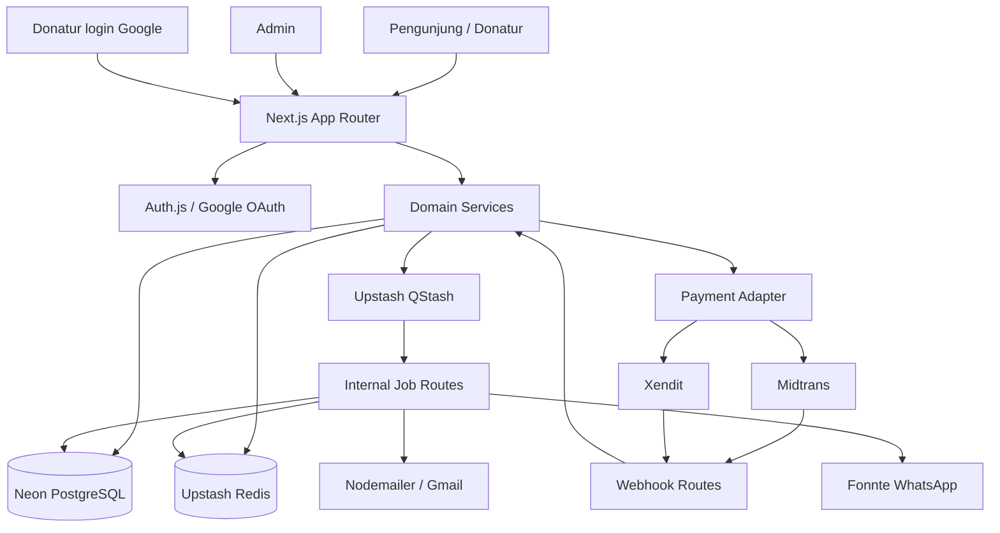
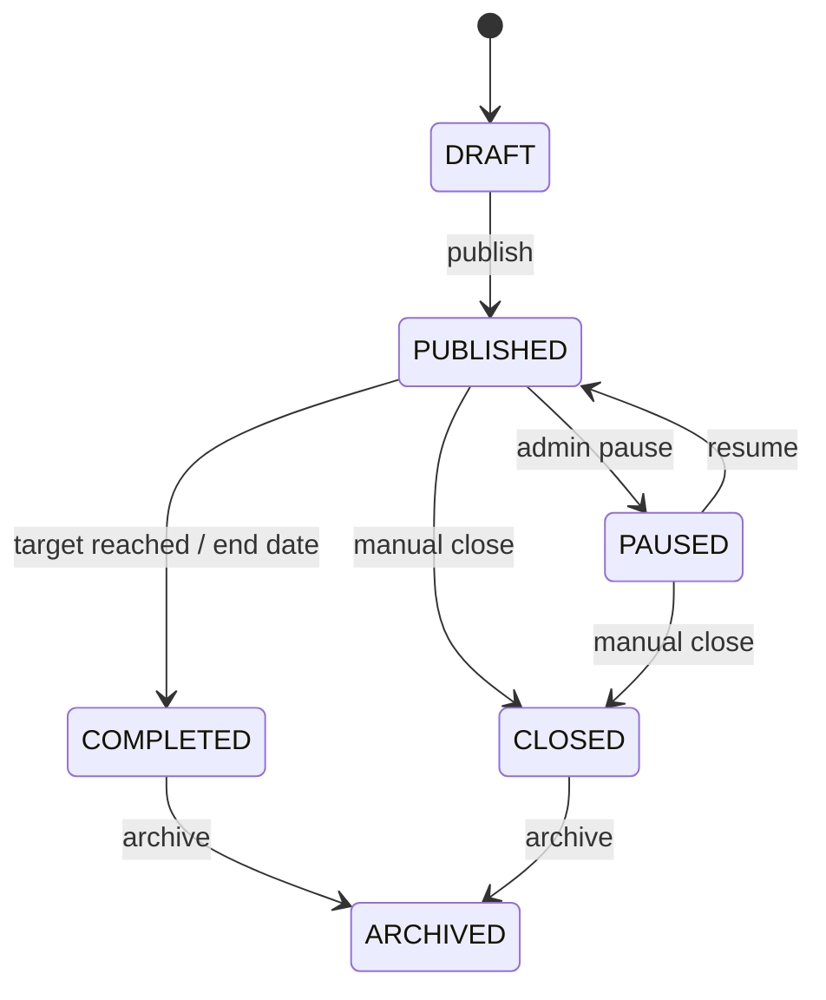
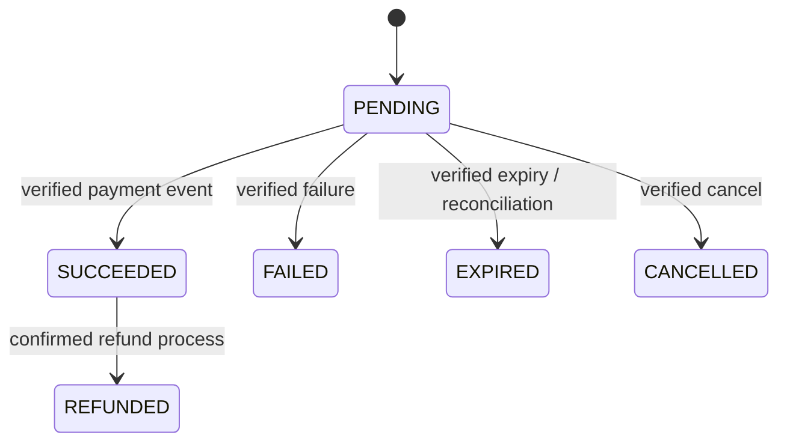

# Technical Requirements Document (TRD)

> **Arsitektur target:** Next.js App Router + TypeScript + Drizzle + Neon PostgreSQL + Upstash Redis/QStash + Midtrans + Xendit + Auth.js.
>
> **Target pertama:** MVP sandbox yang dapat didemokan dalam satu hari.

## 1. Architecture Overview

### 1.1 Stack

| Layer | Pilihan | Catatan |
|---|---|---|
| Web app | Next.js App Router + TypeScript | Public pages, admin, donor dashboard, Route Handlers |
| UI | Tailwind CSS + shadcn/ui + Lucide | Konsisten dan cepat dibuat |
| Forms/validation | React Hook Form + Zod | Client UX dan server validation; server tetap otoritatif |
| ORM | Drizzle ORM + Drizzle Kit | Type-safe schema dan SQL migrations |
| Database | Neon PostgreSQL | Gunakan pooled connection untuk runtime; direct URL untuk migration bila diperlukan |
| Auth | Auth.js + Google provider + Drizzle adapter | Google SSO; RBAC sendiri di DB |
| Cache | Upstash Redis | Campaign summaries, featured lists, rate limits |
| Background queue/cron | Upstash QStash | Notifications, expiry reconciliation, campaign lifecycle |
| Payments | `midtrans-client`, `xendit-node` atau HTTP adapter resmi | Abstraction agar business layer tidak bergantung satu provider |
| Email | Nodemailer + Gmail SMTP OAuth2/App Password | Untuk hackathon; Gmail bukan pilihan ideal untuk volume production |
| WhatsApp | Fonnte API | Server-side request; token rahasia |
| PDF | `pdf-lib` atau `@react-pdf/renderer` | Generate bukti donasi server-side |
| Hosting | Vercel | Preview dan production deployment |
| Source control | GitHub | Main branch protected bila tim lebih dari satu |
| Testing | Vitest + Playwright | Unit/integration + end-to-end |

Pilih versi stabil yang kompatibel saat `pnpm install`; jangan copy versi paket dari artikel lama tanpa memeriksa peer dependencies. Hindari meng-upgrade dependency di tengah hari hackathon.

### 1.2 System Context



### 1.3 Architectural Rules

- Next.js Server Components untuk pembacaan data publik/admin yang aman.
- Client Components hanya untuk interaksi: form, modal, tab, progress polling, dan aksi UI.
- Semua mutasi penting dilakukan melalui Server Actions atau Route Handlers dengan schema validation dan authorization.
- Provider API dipanggil dari server saja.
- Webhook tidak menggunakan session admin; verifikasi dengan signature/token resmi provider.
- Status pembayaran hanya diubah oleh webhook tervalidasi atau status verification server-to-server.
- Domain logic tidak ditempatkan langsung dalam React component/route handler. Route handler memanggil service.
- Redis hanya cache/ephemeral state. PostgreSQL adalah source of truth.

## 2. Repository Structure

```text
src/
  app/
    (public)/
      page.tsx
      campaigns/[slug]/page.tsx
      news/page.tsx
      news/[slug]/page.tsx
      donate/[slug]/page.tsx
      donate/[slug]/payment/page.tsx
      payment/[donationCode]/page.tsx
      payment/[donationCode]/success/page.tsx
      payment/[donationCode]/pending/page.tsx
    (auth)/
      login/page.tsx
    (donor)/
      account/page.tsx
      account/transactions/page.tsx
      account/transactions/[donationCode]/page.tsx
    admin/
      layout.tsx
      page.tsx
      campaigns/page.tsx
      campaigns/[id]/page.tsx
      news/page.tsx
      payment-methods/page.tsx
      transactions/page.tsx
      donors/page.tsx
      notification-templates/page.tsx
      notification-logs/page.tsx
      payment-logs/page.tsx
      brand/page.tsx
      users/page.tsx
    api/
      auth/[...nextauth]/route.ts
      public/campaigns/route.ts
      donations/route.ts
      donations/[donationCode]/status/route.ts
      webhooks/midtrans/route.ts
      webhooks/xendit/route.ts
      receipts/[donationCode]/route.ts
      internal/jobs/notifications/route.ts
      internal/jobs/expire-payments/route.ts
      internal/jobs/campaign-lifecycle/route.ts
  components/
    ui/
    public/
    admin/
    donor/
    forms/
  db/
    index.ts
    schema/
      auth.ts
      users.ts
      campaigns.ts
      donors.ts
      donations.ts
      payments.ts
      content.ts
      notifications.ts
      settings.ts
      audit.ts
    migrations/
    seed.ts
  lib/
    auth/
      auth.ts
      permissions.ts
      session.ts
    env.ts
    validation/
    cache/
      redis.ts
      cache-keys.ts
    qstash/
      client.ts
      publish.ts
    payments/
      types.ts
      registry.ts
      status-mapper.ts
      providers/
        midtrans.ts
        xendit.ts
    notifications/
      templates.ts
      render.ts
      email.ts
      whatsapp.ts
      dispatcher.ts
    pdf/
      donation-receipt.ts
    utils/
  services/
    campaigns.service.ts
    donations.service.ts
    payments.service.ts
    donors.service.ts
    news.service.ts
    notifications.service.ts
    admin.service.ts
  types/
    domain.ts
    api.ts

.claude/
  agents/
    product-analyst.md
    frontend-engineer.md
    backend-payments-engineer.md
    qa-security-reviewer.md

docs/
  PRD.md
  ERD.md
  TRD.md
  SETUP.md
  PUBLISHING-PROMPTS.md
CLAUDE.md
```

Boleh memakai route groups dan folder structure yang berbeda, tetapi pemisahan domain di atas harus tetap jelas.

## 3. Environment Configuration

Buat `.env.example` dari [`SETUP.md`](./SETUP.md). Validasi environment saat server boot menggunakan Zod (`src/lib/env.ts`). Jangan menambahkan secret dengan prefix `NEXT_PUBLIC_`.

Kelompok env:
- Application: `NEXT_PUBLIC_APP_URL`, `APP_ENV`, `DEFAULT_TIMEZONE`.
- Database: `DATABASE_URL`, `DATABASE_URL_DIRECT`.
- Google/Auth.js: `AUTH_SECRET`, `AUTH_GOOGLE_ID`, `AUTH_GOOGLE_SECRET`, `ADMIN_EMAIL_ALLOWLIST`.
- Midtrans: `MIDTRANS_SERVER_KEY`, `MIDTRANS_CLIENT_KEY`, `MIDTRANS_IS_PRODUCTION`.
- Xendit: `XENDIT_SECRET_KEY`, `XENDIT_WEBHOOK_TOKEN`, `XENDIT_API_VERSION` jika diwajibkan oleh SDK/API versi yang digunakan.
- Redis: `UPSTASH_REDIS_REST_URL`, `UPSTASH_REDIS_REST_TOKEN`.
- QStash: `QSTASH_TOKEN`, `QSTASH_CURRENT_SIGNING_KEY`, `QSTASH_NEXT_SIGNING_KEY`.
- Gmail: `SMTP_USER`, `SMTP_APP_PASSWORD` atau OAuth2 credentials yang sesuai.
- Fonnte: `FONNTE_TOKEN`.
- Feature flags: `PAYMENTS_MIDTRANS_ENABLED`, `PAYMENTS_XENDIT_ENABLED`, `NOTIFICATIONS_EMAIL_ENABLED`, `NOTIFICATIONS_WHATSAPP_ENABLED`.

## 4. Database and ORM

### 4.1 Connection

Gunakan Neon pooled connection string untuk runtime serverless. Gunakan direct connection URL untuk migration/administrative tasks jika disarankan oleh Neon project setup. Konfigurasi pool sesuai batas koneksi project. Jangan membuat client database baru per request jika bisa menggunakan module singleton.

Contoh konsep Drizzle dengan `postgres` driver:

```ts
// src/db/index.ts
import "server-only";
import postgres from "postgres";
import { drizzle } from "drizzle-orm/postgres-js";
import * as schema from "./schema";

const connectionString = process.env.DATABASE_URL;
if (!connectionString) throw new Error("DATABASE_URL is required");

const client = postgres(connectionString, {
  max: 1,
  idle_timeout: 20,
  connect_timeout: 10,
  prepare: false,
});

export const db = drizzle(client, { schema });
```

Konfigurasi aktual `max`/timeout disesuaikan dengan Neon pooling dan concurrency Vercel. Untuk operasi yang memerlukan beberapa write saling terkait (webhook settle, raised_amount, outbox/log), gunakan DB transaction yang benar-benar didukung oleh driver yang dipilih.

### 4.2 Migration

- Schema berada di `src/db/schema`.
- Gunakan `drizzle-kit generate` dan `drizzle-kit migrate`.
- Commit migration files ke Git.
- Jangan mengandalkan `drizzle-kit push` untuk perubahan production yang tidak direview.
- Seed untuk development/demo harus idempotent.

### 4.3 Transaction Settlement

Implementasikan settlement sebagai satu transaksi database:
1. Insert webhook event dengan idempotency constraint.
2. Cari payment berdasarkan `(provider, provider_reference)`.
3. Verifikasi nominal dan reference sesuai data internal.
4. Update payment/donation hanya jika status sebelumnya belum `SUCCEEDED`.
5. Jika donation berubah menjadi `SUCCEEDED` untuk pertama kali, naikkan `campaigns.raised_amount` satu kali.
6. Insert payment log, audit/event/outbox notification record.
7. Commit.
8. Setelah commit, invalidasi Redis dan publish notification job.

Jika update payment status dan raised amount dipisah tanpa transaction/conditional update, risiko double counting. Jangan memakai pola `read status → if not paid then increment` di luar transaksi.

## 5. Domain Model and State Machine

### 5.1 Campaign State



`COMPLETED` menyatakan campaign berakhir oleh kondisi target/tanggal. `CLOSED` menyatakan admin menutup manual. Semua state terminal menolak checkout baru.

### 5.2 Donation / Payment State



Jangan memperbolehkan state terminal menjadi `PENDING` karena event provider lama. Refund hanya boleh diproses saat workflow refund tersedia; perubahan manual tidak menggantikan bukti provider.

## 6. Payment Integration Design

### 6.1 Adapter Contract

```ts
export type PaymentProvider = "MIDTRANS" | "XENDIT";

export type CreateCheckoutInput = {
  donationCode: string;
  amount: number;
  currency: "IDR";
  donor: { name: string; email: string; phone?: string };
  channelCode: string;
  successUrl: string;
  pendingUrl: string;
  failureUrl: string;
};

export type NormalizedCheckout = {
  provider: PaymentProvider;
  providerReference: string;
  providerPaymentId?: string;
  checkoutUrl?: string;
  expiresAt?: Date;
  instructionData?: {
    title?: string;
    description?: string;
    accountNumber?: string;
    qrImageUrl?: string;
    actions?: Array<{ label: string; url: string }>;
    rawPublicFields?: Record<string, string>;
  };
  initialStatus: "PENDING";
  rawSafeMetadata?: Record<string, unknown>;
};

export interface PaymentGatewayAdapter {
  createCheckout(input: CreateCheckoutInput): Promise<NormalizedCheckout>;
  verifyAndNormalizeWebhook(request: Request): Promise<NormalizedPaymentEvent>;
  getPaymentStatus(providerReference: string): Promise<NormalizedPaymentEvent | null>;
}
```

`rawSafeMetadata` must never contain secret keys, card numbers, CVV, access tokens, or unneeded PII. Do not expose provider SDK response directly to the client.

### 6.2 Midtrans

- Gunakan Snap API melalui SDK Node.js resmi `midtrans-client` atau request server-to-server yang sesuai dokumentasi.
- Create Snap transaction dilakukan backend dengan `order_id` yang diturunkan dari donation/payment reference unik dan `gross_amount` dari DB.
- Customer details dikirim seperlunya.
- Simpan `token` hanya bila dibutuhkan untuk client integration; prefer simpan `redirect_url` sebagai `checkout_url` untuk Snap Redirect.
- Payment UI provider dapat membuka metode/channel yang diizinkan melalui konfigurasi Snap/`enabled_payments` jika opsi itu didukung untuk channel yang dipilih.
- Webhook endpoint: `POST /api/webhooks/midtrans`.
- Verifikasi `signature_key` sesuai formula SHA-512 atas `order_id + status_code + gross_amount + ServerKey`, atau gunakan fungsi notification resmi SDK yang memvalidasi status dengan provider. Selain signature, cocokkan order id, amount, merchant reference dan payment internal.
- Mapping: `capture`/`settlement` (dengan fraud status yang diterima) → `SUCCEEDED`; `pending` → `PENDING`; `deny` → `FAILED`; `expire` → `EXPIRED`; `cancel` → `CANCELLED`.
- Jangan percaya client callback Snap.js sebagai bukti pembayaran.

### 6.3 Xendit

- Gunakan Payment Request API single-payment flow (`type: PAY`) dan `channel_code` yang dipilih, mengikuti API version/account capability terkini.
- `reference_id` harus berasal dari merchant-side unique reference; `request_amount` harus sama dengan donation amount; currency `IDR`.
- Simpan provider payment request ID dan action URL/checkout URL yang diberikan API.
- Webhook endpoint: `POST /api/webhooks/xendit`.
- Verifikasi header `x-callback-token` dengan `XENDIT_WEBHOOK_TOKEN` menggunakan constant-time comparison.
- Mapping event/status provider ke status internal melalui fungsi khusus dan diuji dengan payload contoh dari dashboard/API docs.
- Cocokkan `reference_id`, `payment_request_id`, amount, dan currency sebelum settlement.

### 6.4 Dual Gateway UI

- `payment_providers.is_enabled` dan env flag harus sama-sama true sebelum ditampilkan.
- `payment_method_configs.is_enabled` menentukan channel yang terlihat.
- Bila provider credential belum tersedia, provider tidak boleh muncul sebagai metode aktif.
- Admin dapat memilih sort order.
- Channel-specific details bersifat dinamis; jangan hardcode asumsi bahwa QRIS/VA tersedia di semua akun merchant.

### 6.5 Webhook Safety

- Endpoint publik menerima POST tanpa login; security dari signature/token provider.
- Parse raw body sesuai requirement provider.
- Verifikasi signature/token sebelum update DB.
- Lakukan idempotent processing dengan unique event key dan payment reference.
- Return 2xx hanya setelah event diterima/dicatat secara aman; jika processing gagal sementara, return error yang mendorong retry sesuai kebijakan provider.
- Jangan mengirim email/WhatsApp atau generate PDF di dalam webhook request. Queue job setelah settlement.
- Simpan payload yang telah disanitasi dan log correlation ID.
- Tambahkan endpoint internal status reconciliation jika webhook terlambat.

## 7. Donation Checkout API Contract

Semua payload menggunakan JSON, response konsisten, dan validasi Zod. Nama endpoint dapat disesuaikan, tetapi tanggung jawabnya dipertahankan.

### 7.1 `POST /api/donations`

Request:

```json
{
  "campaignSlug": "bantu-pendidikan-anak",
  "amount": 50000,
  "amountOptionId": null,
  "donor": {
    "name": "Nama Donatur",
    "email": "donor@example.com",
    "whatsapp": "+6281234567890",
    "whatsappOptIn": true
  },
  "message": "Semoga bermanfaat",
  "isAnonymous": false
}
```

Response:

```json
{
  "donationCode": "DON-...",
  "status": "PENDING",
  "nextStep": "SELECT_PAYMENT"
}
```

Aturan:
- Validasi campaign published, jadwal aktif, belum closed/completed, dan amount mode.
- Untuk closed amount, validate `amountOptionId` dan amount dari DB; jangan percaya nilai amount bebas.
- Upsert donor dengan normalized email; simpan snapshot.
- Buat donation `PENDING` dan idempotency key untuk mencegah double submit.

### 7.2 `POST /api/donations/{donationCode}/payments`

Request:

```json
{
  "provider": "MIDTRANS",
  "channelCode": "qris"
}
```

Response:

```json
{
  "donationCode": "DON-...",
  "payment": {
    "provider": "MIDTRANS",
    "status": "PENDING",
    "checkoutUrl": "https://...",
    "expiresAt": null,
    "instructions": null
  }
}
```

Server memvalidasi donation masih pending, provider/channel aktif, amount dari DB, dan tidak membuat attempt ganda tanpa kebijakan retry yang jelas. Simpan payment record sebelum mengembalikan redirect. Jika provider call gagal, payment log menyimpan failure dan donation tetap tidak paid.

### 7.3 `GET /api/donations/{donationCode}/status`

Response minimum: donationCode, donation status, amount, campaign title, paidAt, expiresAt, latest payment status. Tidak mengembalikan donor email/phone ke public unauthenticated response.

### 7.4 Webhooks

- `POST /api/webhooks/midtrans`
- `POST /api/webhooks/xendit`

Tidak ada response field yang digunakan browser untuk menentukan status sukses.

## 8. API Route Matrix

| Method | Endpoint | Auth | Fungsi |
|---|---|---|---|
| GET | `/api/public/campaigns` | Public | Campaign published |
| GET | `/api/public/campaigns/[slug]` | Public | Detail campaign dan ringkasan |
| GET | `/api/public/news` | Public | News published |
| GET | `/api/public/news/[slug]` | Public | Detail news |
| POST | `/api/donations` | Guest | Create donation |
| POST | `/api/donations/[code]/payments` | Guest + rate limit | Create checkout provider |
| GET | `/api/donations/[code]/status` | Guest + code lookup/rate limit | Check payment status |
| POST | `/api/webhooks/midtrans` | Provider signature | Midtrans notification |
| POST | `/api/webhooks/xendit` | Callback token | Xendit webhook |
| GET | `/api/receipts/[code]` | Donor owner/Admin | Download PDF |
| GET/POST | `/api/auth/[...nextauth]` | Auth.js | Google SSO |
| GET/POST/PATCH/DELETE | `/api/admin/campaigns` | Campaign/Super | Campaign CRUD |
| GET/POST/PATCH/DELETE | `/api/admin/news` | Content/Super | News CRUD |
| GET/PATCH | `/api/admin/payment-methods` | Super/Finance per permission | Payment config |
| GET | `/api/admin/transactions` | Finance/Super | Transaction listing |
| GET | `/api/admin/donors` | Finance/Super | Donor listing |
| GET/PATCH | `/api/admin/notification-templates` | Super/Content as desired | Template CRUD |
| GET | `/api/admin/notification-logs` | Finance/Super | Notification log |
| GET | `/api/admin/payment-logs` | Finance/Super | Payment log |
| PATCH | `/api/admin/brand` | Super | Brand config |
| POST | `/api/internal/jobs/notifications` | QStash signature | Dispatch notification |
| POST | `/api/internal/jobs/expire-payments` | QStash signature | Reconcile expired pending |
| POST | `/api/internal/jobs/campaign-lifecycle` | QStash signature | Close campaigns by date/target |

## 9. Authentication and Authorization

### 9.1 Auth.js

- Google OAuth only for donor/admin login.
- Auth.js user/session data persisted using Drizzle adapter.
- Callback URL must match local and deployment URL.
- Use `AUTH_SECRET` generated securely.
- Do not trust `role` from Google profile.
- Super Admin bootstrap from allowlisted email, after `email_verified` confirmation.

### 9.2 RBAC

Buat permission helper:

```ts
export type Permission =
  | "campaign:read" | "campaign:write" | "campaign:publish"
  | "news:read" | "news:write" | "news:publish"
  | "payment:read" | "payment:configure"
  | "transaction:read" | "transaction:annotate"
  | "donor:read"
  | "notification:read" | "notification:configure"
  | "brand:configure"
  | "admin:manage";
```

Map role → permissions di `permissions.ts`; validasi di server service/API. Sembunyikan tombol di UI hanya untuk UX, bukan authorization.

## 10. Redis Cache and Rate Limiting

### 10.1 Cache

Contoh keys:

- `home:featured-campaigns:v1`
- `campaign:{slug}:detail:v1`
- `campaign:{id}:summary:v1`
- `news:latest:v1`
- `brand:config:v1`

TTL awal: 30–120 detik. Admin publish/update campaign/news harus invalidate cache terkait. Setelah donation menjadi succeeded, invalidate campaign summary dan homepage featured campaign. PostgreSQL tetap source of truth.

Jangan cache private donor profile/transaction tanpa key isolation dan invalidation yang benar. MVP boleh query langsung untuk dashboard donor.

### 10.2 Rate limit

Gunakan Upstash Ratelimit/Redis untuk:
- Create donation per IP dan email hash.
- Payment checkout create per donation code.
- Status polling per IP/code.
- Login attempt jika diperlukan.

Jangan menyimpan raw IP/email dalam key; hash/normalize sesuai kebutuhan. Jangan memblokir webhook gateway berdasarkan rate limit pengunjung.

## 11. QStash Background Jobs and Schedules

### 11.1 Jobs

1. `notifications`: render template, dispatch email/WA, update notification log.
2. `expire-payments`: cari payment pending lewat expiry; cek provider status sebelum menandai expired.
3. `campaign-lifecycle`: tutup campaign yang `ends_at` sudah lewat dan target yang sudah tercapai.
4. Opsional `payment-reconciliation`: cek payment pending yang usianya melewati threshold.

Semua job route wajib diverifikasi dengan signature QStash. Internal route tidak boleh menerima job tanpa signature.

### 11.2 Schedules awal

| Job | Cron | Keterangan |
|---|---|---|
| Campaign lifecycle | `*/5 * * * *` | Tiap 5 menit |
| Pending payment reconciliation | `*/10 * * * *` | Tiap 10 menit; panggil provider status API seperlunya |
| Notification retry sweep | `*/15 * * * *` | Opsional; job failed retryable |

QStash cron default memakai UTC. Jika jadwal menggunakan jam lokal, konversikan secara eksplisit atau atur timezone fitur schedule. Simpan schedule ID agar dapat di-update/dihapus.

## 12. Notification Architecture

### 12.1 Flow

1. Domain event tercipta (`DONATION_CREATED`, `PAYMENT_SUCCEEDED`, `PAYMENT_EXPIRED`).
2. Buat notification job/outbox entry dengan idempotency key.
3. Publish ke QStash.
4. QStash memanggil internal route yang memverifikasi signature.
5. Dispatcher memuat template aktif dan data donation.
6. Render placeholder dengan allowlist.
7. Kirim via email/WhatsApp sesuai consent dan feature flag.
8. Catat `SENT`, `FAILED`, atau `SKIPPED` beserta provider response tersanitasi.

### 12.2 Nodemailer/Gmail

- Gunakan OAuth2 atau Google App Password jika 2-Step Verification aktif.
- Jangan gunakan password Gmail utama.
- Gunakan transporter singleton server-side.
- `verify()` SMTP saat startup/manual diagnostic, bukan pada setiap request.
- Tangani Gmail quota dan anti-abuse errors.
- Gmail SMTP cocok untuk demo/volume rendah; pindah ke transactional email provider jika volume naik.

### 12.3 Fonnte

- Request dari server ke Fonnte API.
- Token ada di env dan dikirim pada header Authorization sesuai dokumentasi.
- Normalisasi nomor ke format yang diharapkan provider.
- Hanya kirim WhatsApp jika `whatsapp_opt_in_snapshot = true`.
- Simpan response status, message id, dan error tanpa menyimpan token.

## 13. PDF Receipt

Route `GET /api/receipts/[donationCode]`:
1. Ambil session user.
2. Cari donation, donor, campaign, brand config.
3. Pastikan status `SUCCEEDED`.
4. Pastikan donor terhubung ke user, atau role user berwenang.
5. Generate PDF dari snapshot.
6. Return `Content-Type: application/pdf` dan attachment filename.

Gunakan istilah `Bukti Donasi`; jangan menyatakan status pajak atau legalitas receipt tanpa konfirmasi organisasi.

## 14. Security Requirements

- Validate every request with Zod on server.
- Server-only environment secrets; jangan expose ke `NEXT_PUBLIC_*`.
- Webhook verification sebelum DB settlement.
- Payment amount/reference harus cocok dengan record internal.
- Idempotency untuk checkout create, webhook, settlement, notifications.
- Role check untuk setiap admin mutation dan data read sensitif.
- Authenticated ownership check untuk donor receipts dan transaction details.
- Rate limiting pada guest endpoints.
- Sanitize Markdown/HTML; jangan render arbitrary unsanitized HTML.
- Validate URL inputs untuk image/checkout redirects; hanya HTTPS provider URLs dan allowlisted hosts untuk redirect provider.
- CSRF protection mengikuti mekanisme framework; jangan menambahkan custom endpoint yang menerima state-changing GET.
- Secure cookies, HTTPS production, secure headers, restrictive CORS.
- Mask/sanitize PII dan secret dalam logs.
- Audit log untuk perubahan campaign status, payment config, brand config, roles, dan notifikasi template.
- Database backup/retention mengikuti paket Neon dan kebutuhan organisasi.

## 15. Logging and Observability

Setiap payment flow memakai `correlation_id`/donation_code untuk tracing. Log minimum:
- Donation create validation result.
- Payment request provider, reference, latency, safe error code.
- Webhook received/verified/duplicate/processed.
- Settlement old status → new status.
- Notification queued/sent/failed.
- QStash delivery attempt.

Jangan log raw request header Authorization, secrets, full webhook tokens, card details, CVV, atau raw OAuth tokens.

## 16. Testing Strategy

### Unit tests
- Open amount accepts valid free amount and rejects under/over limit.
- Closed amount accepts only active preset.
- Campaign lifecycle transitions.
- Payment status mapping per provider.
- Idempotency/status monotonicity.
- Role permission mapping.
- Notification template placeholder rendering/escaping.

### Integration tests
- Neon test database schema/migrations.
- Donation create + payment attempt persistence.
- Midtrans signature valid/invalid.
- Xendit callback token valid/invalid.
- Webhook duplicate event.
- Settlement increments raised amount once.
- Campaign target close after successful payment.

### E2E (Playwright)
1. Home → campaign → guest checkout.
2. Open amount flow.
3. Closed amount flow.
4. Provider sandbox checkout to pending.
5. Simulated/real sandbox webhook to success.
6. Google login → donor transaction list → receipt download.
7. Admin login → create/publish campaign → public view.

Never test with real card/real production money during ordinary CI.

## 17. Deployment and CI/CD

### Environments

- Local: `.env.local`, Neon development branch, sandbox gateways.
- Preview: Vercel preview URL, test OAuth redirect URI, sandbox gateway webhook URLs.
- Production: production domain, production Neon branch, live payment keys only after checklist.

### Pipeline

On Pull Request:
1. Install using lockfile.
2. `pnpm lint`.
3. `pnpm typecheck`.
4. `pnpm test`.
5. `pnpm build`.

On merge to main:
- Vercel preview/production deploy sesuai branch settings.
- Migration run harus eksplisit/terkontrol sebelum traffic menerima schema baru.
- Secrets disimpan di Vercel Project Environment Variables, tidak di repo.

### Release gates

- Confirm Google OAuth authorized origins and redirect URI.
- Confirm payment production credentials and webhook URL per gateway.
- Test valid payment, pending, failed, expired, duplicate webhook.
- Confirm Fonnte device status and message test.
- Confirm email delivery and sender policy.
- Confirm brand/legal/privacy content.
- Enable production payment provider only after end-to-end test.

## 18. Technical Dependencies (Initial)

Install only what is required; align package versions before coding.

```bash
pnpm add drizzle-orm postgres
pnpm add next-auth @auth/drizzle-adapter
pnpm add @upstash/redis @upstash/ratelimit @upstash/qstash
pnpm add midtrans-client xendit-node
pnpm add nodemailer zod react-hook-form @hookform/resolvers
pnpm add react-markdown remark-gfm rehype-sanitize
pnpm add pdf-lib date-fns lucide-react
pnpm add -D drizzle-kit tsx eslint eslint-config-next @types/nodemailer vitest @playwright/test prettier
```

If using a different Neon driver, remove unused driver dependency. UI primitives are installed through the shadcn CLI. Avoid installing both PDF libraries; choose one.

## 19. Risks / Engineering Trade-offs

- Midtrans Snap may host the detailed method selection/instructions. Internal UI should not pretend every gateway provides the same instruction fields.
- Xendit channel availability is account- and channel-dependent. Configure only methods enabled for the merchant.
- Gmail is not designed as a high-volume transactional email service. Use for hackathon; isolate behind `EmailProvider` interface.
- Fonnte delivery depends on its connected device/service status. WhatsApp is best-effort and should not control payment status.
- One-day MVP cannot guarantee production certification, all payment channels, all webhook edge cases, and every admin report. Protect payment correctness first.

## 20. Official Technical References

- Next.js Route Handlers: https://nextjs.org/docs/app/getting-started/route-handlers
- Next.js Environment Variables: https://nextjs.org/docs/pages/guides/environment-variables
- Auth.js: https://authjs.dev/getting-started
- Auth.js Google Provider: https://authjs.dev/getting-started/providers/google
- Auth.js Drizzle Adapter: https://authjs.dev/getting-started/adapters/drizzle
- Drizzle + Neon: https://orm.drizzle.team/docs/connect-neon
- Neon connection guide: https://neon.com/docs/get-started/connect-neon
- Upstash Redis TypeScript SDK: https://upstash.com/docs/redis/sdks/ts/overview
- Upstash QStash Next.js: https://upstash.com/docs/qstash/quickstarts/vercel-nextjs
- Upstash QStash schedules: https://upstash.com/docs/qstash/features/schedules
- Upstash QStash signature verification: https://upstash.com/docs/qstash/howto/signature
- Midtrans Snap integration: https://github.com/Midtrans/technical-documentation-site/blob/master/en/snap/integration-guide.md
- Midtrans HTTP notifications: https://docs.midtrans.com/docs/https-notification-webhooks
- Xendit Create Payment Request: https://docs.xendit.co/apidocs/create-payment-request
- Xendit payment webhook: https://docs.xendit.co/apidocs/payment-webhook-notification
- Fonnte API send message: https://docs.fonnte.com/api-send-message/
- Nodemailer Gmail guide: https://nodemailer.com/guides/using-gmail
- Vercel environment variables: https://vercel.com/docs/environment-variables
